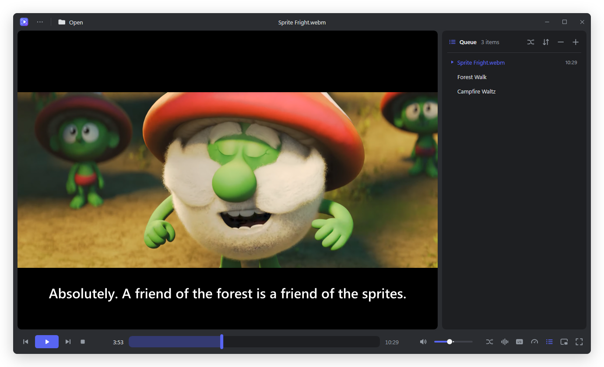
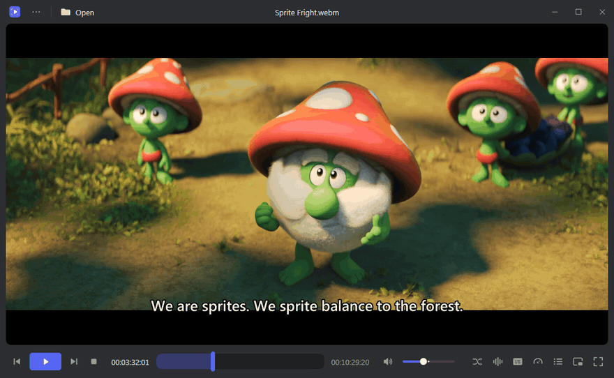
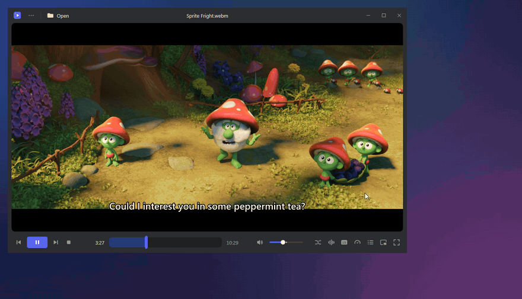
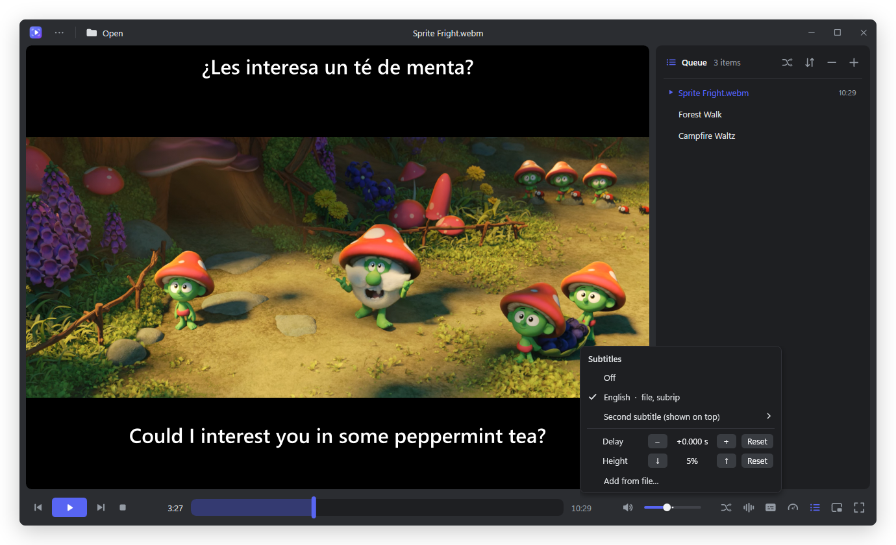
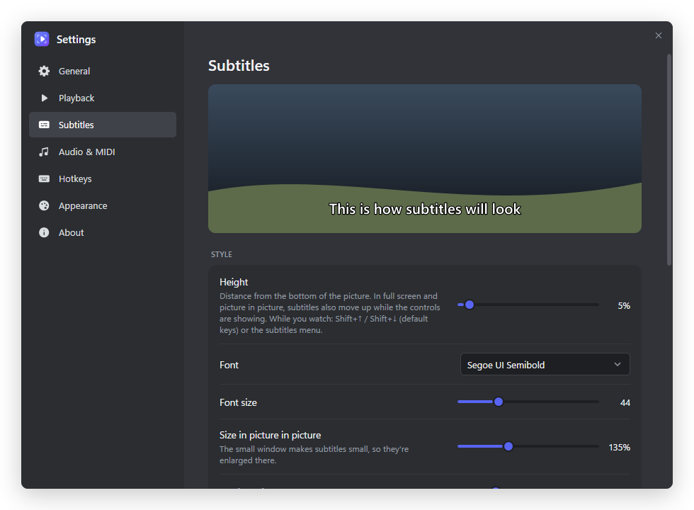
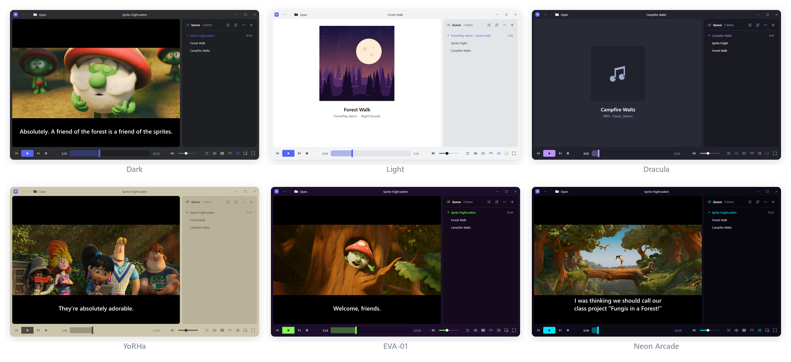

<p align="center">
  
</p>

<h1 align="center">FramePlay</h1>

<p align="center">
  A lightweight, fast media player for Windows with frame-exact controls.<br>
  Built on mpv (libmpv) for playback and MeltySynth for MIDI, with a modern WPF interface.
</p>

<p align="center">
  <a href="https://github.com/shinnahu/FramePlay/releases/latest"><b>Download the installer</b></a>
  &nbsp;·&nbsp; Windows 10/11, 64-bit &nbsp;·&nbsp; English and Español
</p>



## Download

Get `FramePlay-Setup-<version>.exe` from the [latest release](https://github.com/shinnahu/FramePlay/releases/latest).

**What Setup asks:**
- The language for Setup and for FramePlay (English or Español).
- Whether to install for you only (no admin rights needed) or for all users.
- Whether to include the 90 MB MIDI soundfont.
- Whether to create a desktop shortcut.
- Whether to add FramePlay to "Open with" and Default apps.

FramePlay needs the free Microsoft .NET 8 Desktop Runtime. If it's missing, Setup offers to download it from Microsoft.

The installer isn't code-signed, so Windows SmartScreen may warn the first time. Choose **More info › Run anyway**.

## Highlights

### Frame-exact, like Premiere Pro

The arrow keys move exactly one frame (Shift+arrows move five). Right-click the time to switch between `h:mm:ss`, timecode (`hh:mm:ss:ff`) and frame numbers. Hover the seek bar to preview any moment.



### Picture in picture, like YouTube

- One click shrinks the player to a small window that stays on top in the corner of the screen.
- Hover it for controls; drag it anywhere.
- Resize it from any edge; it keeps the video's shape.
- When the video ends it stays on the last frame, in the small window.
- Double-click it, or press Esc, to go back.



### Subtitles and audio tracks

- **Tracks:** pick any track, or add one from a file. Each file remembers its own.
- **Delay:** fix out-of-sync subtitles or audio in 50 ms steps (Z / X for subtitles, Shift+Z / Shift+X for audio).
- **Two languages at once:** show a second subtitle at the top.
- **Height:** set it in Settings or in the subtitles menu, or with Shift+↑ / Shift+↓ while you watch.
- **Never covered:** in full screen and picture in picture, subtitles slide up above the controls while they're showing.
- **Bigger in picture in picture:** 135 % by default, adjustable.



**Style, with a live preview:**
- Font, size and outline thickness.
- Text and outline colours.
- Shadow and background box.
- Default encoding, and whether to apply the style to `.ass` subtitles too.



### Themes

It ships with the MarkNotes themes. You can create, edit, import and export your own as `.mntheme` files, which MarkNotes opens too. A theme can also give the seek bar, the volume and the buttons that are on their own colours, as the PS1 theme does with the four PlayStation button colours.



## What it plays

- **Video:** MP4 (H.264 + AAC), MKV, WebM, MOV and AVI, plus most other formats mpv supports.
- **Audio:** MP3, WAV, M4A and FLAC, with cover art.
- **MIDI:** .mid, .midi, .kar and .rmi, played through a SoundFont.
  - The default soundfont is "Classic Station".
  - **Settings › Audio & MIDI** lists every `.sf2` file in FramePlay's folder, so you can add your own.

## More features

- **Screenshots:** lossless PNG at the video's full resolution, from the right-click menu or Ctrl+Shift+E.
- **Queue:** random order, drag to reorder, drop files or whole folders.
- **Per-file memory:** remembers the position, tracks and delays of every file.
- **Single instance:** files opened from File Explorer play in the window that's already open. This is on by default; see **Settings › General**.
- **Always on top:** while a video plays, or any time with Ctrl+T.
- **Pause on the last frame** instead of moving on to the next item.
- **Hotkeys:** every one can be changed.

## Hotkeys

These are the defaults. Change them in **Settings › Hotkeys**: click a shortcut, then press the new keys.

| Action | Keys |
|---|---|
| Play / pause | Space, K |
| Next / previous frame | Right / Left, or . / , |
| 5 frames forward / back | Shift+Right / Shift+Left |
| Forward / back 10 seconds | L / J |
| Forward / back 5 seconds | Ctrl+Right / Ctrl+Left |
| Jump to 10 %…90 % | 1…9 |
| Start / last frame | Home or 0 / End |
| Volume up / down, mute | Up / Down, M |
| Faster / slower / normal speed | Shift+. / Shift+, / Shift+0 |
| Full screen | F or F11 (Esc leaves) |
| Picture in picture | I |
| Subtitles on/off | C |
| Subtitles earlier / later | Z / X |
| Subtitles higher / lower | Shift+Up / Shift+Down |
| Audio earlier / later | Shift+Z / Shift+X |
| Screenshot | Ctrl+Shift+E or F12 |
| Next / previous in queue | Shift+N / Shift+P |
| Random | Shift+R |
| Queue panel | Ctrl+L |
| Always on top | Ctrl+T |
| Open file / folder | Ctrl+O / Ctrl+Shift+O |
| Settings | Ctrl+, |

**Mouse:**
- Double-click the video for full screen.
- The wheel changes the volume.
- Right-click opens the menu.

## Build from source

You need the .NET 8 SDK. Two large files aren't in Git; put them here first:

- `third_party\libmpv\libmpv-2.dll`: from the `mpv-dev-x86_64` build of [shinchiro/mpv-winbuild-cmake](https://github.com/shinchiro/mpv-winbuild-cmake/releases), snapshot `20261108-git-55d3feb45c`.
- `assets\soundfonts\Classic_Station.sf2`: the default soundfont, from [musical-artifacts.com](https://musical-artifacts.com/artifacts/2282).

**Run it:**
```
dotnet run --project src\FramePlay
```

**Build the installer** (publishes the app, then compiles `installer\FramePlay.iss` with Inno Setup 6.7):
```
powershell -ExecutionPolicy Bypass -File installer\build-installer.ps1
```

The setup lands in `dist\`. If Inno Setup isn't installed, the script fetches it from NuGet.

**For testing:**
- `--data-dir=<folder>` uses a separate settings profile.
- `FRAMEPLAY_TIMING=1` logs startup times.
- `FRAMEPLAY_MPV_LOG=v` writes mpv's detailed log.

All logs go to `%LOCALAPPDATA%\FramePlay\logs`.

## Known limits

- For variable-frame-rate files, frame numbers and timecode are estimates (time × frame rate). Frame stepping itself is still exact.
- Messages over the video ("Volume: 80%") are drawn by mpv, because Windows can't put the app's own controls on top of the video surface.

## Credits and licences

FramePlay is free software under the [GNU GPL v3](LICENSE) or later. [THIRD-PARTY-NOTICES.md](THIRD-PARTY-NOTICES.md) has the details for:

- **Playback:** [mpv / libmpv](https://mpv.io), GPL.
- **MIDI:** [MeltySynth](https://github.com/sinshu/meltysynth) and [NAudio](https://github.com/naudio/NAudio), both MIT.
- **Design and icons:** adapted from a media player design by [Juxtopposed](https://www.figma.com/@juxtopposed) (Figma Community), [CC BY 4.0](https://creativecommons.org/licenses/by/4.0/).
- **Themes:** from MarkNotes.
- **Default soundfont:** "Classic Station" by Yingchun Soul, CC0.

**Screenshots:**
- The film is [*Sprite Fright*](https://studio.blender.org/films/sprite-fright/) by Blender Studio, © Blender Foundation | studio.blender.org, [CC BY 4.0](https://creativecommons.org/licenses/by/4.0/).
- Its English and Spanish subtitles are by [Wikimedia Commons](https://commons.wikimedia.org/wiki/File:Sprite_Fright_-_Blender_Open_Movie-full_movie.webm) contributors, CC BY-SA 4.0.
- The "Forest Walk" cover art was made for this README.
